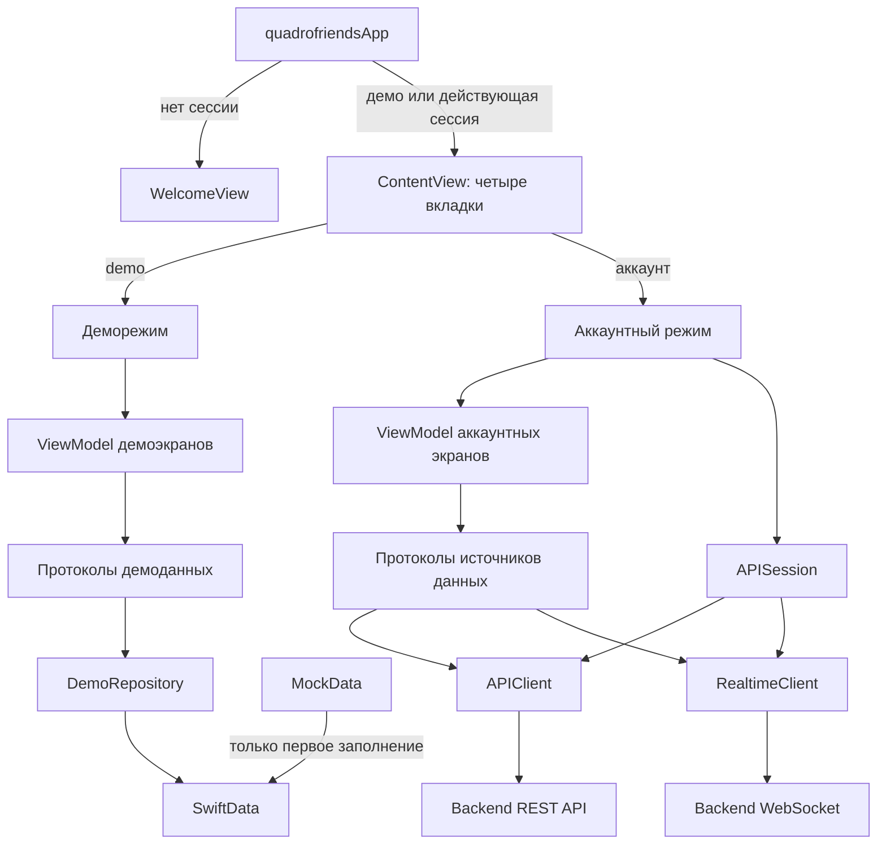

# quadrofriends — архитектура iOS-приложения

Приложение написано на SwiftUI и MapKit. Список чатов и переписка используют UIKit внутри вкладки SwiftUI. В проекте есть два режима: вход в аккаунт с данными backend и деморежим с данными в SwiftData. Исходники сгруппированы по функциям приложения и входят в один Xcode-проект; targets `quadrofriends` и `quadrofriendsCopy` используют одну папку с кодом.

## Краткая карта файлов

### Корень проекта

| Файл или папка | За что отвечает |
| --- | --- |
| `quadrofriends.xcodeproj/project.pbxproj` | Два app target, настройки сборки и подключение исходников. |
| `quadrofriends.xcodeproj/xcshareddata/xcschemes/quadrofriendsCopy.xcscheme` | Общая схема запуска и сборки второго target. |
| `Config.xcconfig` | Общий адрес API для сборок. |
| `Local.xcconfig.example` | Пример локального переопределения адреса API; рабочий `Local.xcconfig` игнорируется Git. |
| `Info.plist` | Метаданные приложения и разрешение на использование геопозиции. |
| `quadrofriends.entitlements` | Associated Domains для домена API. |
| `deployment/apple-app-site-association.template.json` | Шаблон файла Universal Links для сервера. |
| `API_SETUP.md` | Настройка подключения к backend и сценарии проверки. |
| `BACKEND_API.md` | Контракт HTTP API и WebSocket. |
| `PROJECT_STRUCTURE.md` | Короткие правила размещения исходников. |
| `VK_ID_SETUP.md` | Архивная инструкция по прежней интеграции VK ID; текущий вход работает по email и паролю. |
| `design-qa.md`, `artifacts/` | Заметки и снимки проверки интерфейса. |
| `deliverables/Квадро_Друзья_актуальная_реализация.pptx` | Презентация проекта для защиты, 9 слайдов. |
| `quadrofriends/Assets.xcassets/` | Цвета, иконка, логотип и изображения демонстрационных маршрутов. |

### `quadrofriends/App/`

| Файл | За что отвечает |
| --- | --- |
| `quadrofriendsApp.swift` | Точка входа, общие объекты, выбор экрана входа или основного приложения. |
| `ContentView.swift` | Четыре вкладки, выбор серверных или демоэкранов, запуск и остановка WebSocket. |

### `quadrofriends/Core/`

| Файл | За что отвечает |
| --- | --- |
| `MockData.swift` | Начальные примеры маршрутов, чатов и сообщений; используются только для первого заполнения SwiftData. |
| `DemoRepository.swift` | Модель `DemoRecord`, контейнер SwiftData, первоначальное заполнение и протоколы доступа к маршрутам, профилю и чатам. |
| `Models/ChatModels.swift` | Модели списка чатов, сообщений и геопозиции для интерфейса. |
| `Models/ProfileModels.swift` | Локальные модели профиля и техники для деморежима. |
| `Models/RouteModels.swift` | Модели демонстрационных маршрутов, авторов и папок. |
| `Components/SharedComponents.swift` | Переиспользуемые SwiftUI-компоненты: аватар, строка маршрута, теги, кнопки. |
| `Theme/AppTheme.swift` | Выбор системной, светлой или тёмной темы и общий фон. |

### `quadrofriends/Core/Networking/`

| Файл | За что отвечает |
| --- | --- |
| `APIConfiguration.swift` | Читает базовый адрес API из настроек приложения и строит адрес WebSocket. |
| `APIClient.swift` | Выполняет типизированные HTTP-запросы, кодирует JSON, загружает изображения и обрабатывает ответы. |
| `APIError.swift` | Единый тип сетевых и серверных ошибок. |
| `APIModels.swift` | Общие DTO: страницы, координаты, медиа, пользователь, сессия и профиль аккаунта. |
| `APISession.swift` | Вход, регистрация, выход, хранение токенов и обновление сессии. |
| `KeychainStore.swift` | Сохранение и чтение сессии в Keychain. |
| `RealtimeClient.swift` | WebSocket, переподключение и публикация событий. |
| `RemoteImageLoader.swift` | Загрузка удалённых изображений с кешем в памяти. |

### `quadrofriends/Features/Auth/`

| Файл | За что отвечает |
| --- | --- |
| `WelcomeView.swift` | Вход по email и паролю, регистрация и переход в деморежим. |

### `quadrofriends/Features/Chats/`

| Файл | За что отвечает |
| --- | --- |
| `API/ChatDTOs.swift` | DTO чатов, сообщений, передачи геопозиции и событий WebSocket. |
| `API/ChatsAPI.swift` | Конкретные HTTP-вызовы для чатов, сообщений и геопозиции. |
| `API/ChatsRepository.swift` | Общий интерфейс данных чата и две реализации: серверная и демонстрационная. |
| `ChatsViewModels.swift` | ViewModel списка, переписки и создания чата; протокол и серверный источник поиска пользователей. |
| `ChatsViewController.swift` | Встраивание вкладки UIKit в SwiftUI, список чатов, поиск и навигация. |
| `ChatViewController.swift` | Экран переписки, пагинация, отправка и обработка новых событий. |
| `ChatMessageCell.swift` | Ячейки сообщений, карточка геопозиции и заголовок дня. |
| `ChatInputBar.swift` | Поле ввода и действия для отправки сообщения. |
| `ChatUIKitComponents.swift` | Общие UIKit-компоненты и оформление аватаров. |
| `ChatLocationBannerView.swift` | Плашка активной передачи геопозиции над перепиской. |
| `ChatLocationSharingStore.swift` | Геопозиция устройства, создание и остановка передач, синхронизация с сервером. |
| `ChatLiveLocationViews.swift` | SwiftUI-окна согласия, участников и карты с текущими позициями. |
| `NewChatView.swift` | Создание чата и выбор участников. |

### `quadrofriends/Features/Map/`

| Файл | За что отвечает |
| --- | --- |
| `MapHomeView.swift` | Демокарта с примерами маршрутов, поиском и демонстрацией записи. |
| `MapComponents.swift` | Контролы карты, маркеры и элементы интерфейса записи. |
| `MapRouteSearchModal.swift` | Поиск и фильтры маршрутов на демокарте. |
| `MapSearchFilters.swift` | Вид карты и типы фильтров для демомаршрутов. |
| `MapSettingsView.swift` | Выбор вида карты и темы приложения. |
| `ServerMapView.swift` | Серверная карта: загрузка маршрутов и геометрии, поиск и выбор маршрута. |
| `MapLocationRecordingStore.swift` | Получение GPS-точек и отправка записи маршрута на сервер. |
| `ServerRecordingForms.swift` | Формы метки на записываемом маршруте и публикации записи. |

### `quadrofriends/Features/Routes/`

| Файл | За что отвечает |
| --- | --- |
| `MyRoutesView.swift` | Демосписок недавних, приватных маршрутов и папок. |
| `DemoRoutesViewModel.swift` | Подготавливает маршруты и папки из протокола `DemoRoutesDataSource` для демокарты, поиска, деталей и профиля. |
| `RouteSearchView.swift` | Поиск по демонстрационным маршрутам. |
| `RouteDetailView.swift` | Детали демонстрационного маршрута. |
| `RouteEditorView.swift` | Демоформа редактирования маршрута. |
| `RouteMarkerView.swift` | Демопросмотр и редактирование меток маршрута. |
| `ShareRouteView.swift` | Демоинтерфейс доступа к маршруту и ссылки. |
| `ServerMyRoutesView.swift` | Серверные списки своих маршрутов и папок. |
| `ServerRoutes.swift` | Серверные модели, строка и экран деталей маршрута. |
| `ServerRoutesDataSource.swift` | Протокол серверных маршрутов и реализация HTTP-запросов: списки, папки, геометрия, закладки и публикация записи. |
| `ServerRoutesViewModels.swift` | Состояние загрузки и действия для серверных списков, поиска, деталей, папок и публикации записи. |

### `quadrofriends/Features/Profile/`

| Файл | За что отвечает |
| --- | --- |
| `ProfileView.swift` | Профиль: локальные данные в деморежиме, данные аккаунта с сервера после входа. |
| `ProfileStore.swift` | Наблюдаемое состояние демопрофиля: чтение и сохранение через `DemoProfileDataSource` в SwiftData. |
| `EditProfileView.swift` | Редактирование демонстрационного профиля и техники. |
| `AccountProfileEditorView.swift` | Редактирование серверного профиля и техники аккаунта. |
| `AccountProfileViewModel.swift` | Загрузка профиля аккаунта и публичных маршрутов через протокол серверного источника. |
| `AccountEditingViewModel.swift` | Протокол, серверный источник и действия редактирования профиля и техники. |

## Подробно об архитектуре

### Запуск приложения и выбор источника данных

`quadrofriendsApp` создаёт объекты, которые нужны нескольким вкладкам: `APISession`, `RealtimeClient`, `ChatLocationSharingStore` и `ProfileStore`. Они передаются экранам через SwiftUI `environmentObject`. Значение `sessionKind` хранится в `AppStorage`: `demo` открывает приложение без входа, а действующая серверная сессия открывает аккаунтный режим. В остальных случаях показывается `WelcomeView`.

`ContentView` содержит `TabView` с вкладками «Карта», «Маршруты», «Чаты» и «Профиль». Карта, маршруты и профиль открываются в `NavigationStack`. Для карты и маршрутов выбираются разные экраны в деморежиме и аккаунтном режиме. Вкладка чатов встроена через `UIViewControllerRepresentable` и использует собственный `UINavigationController`. При появлении основного экрана запускаются WebSocket и синхронизация передач геопозиции; при уходе приложения в фон WebSocket останавливается.

### Сетевой слой и сессия

`APIConfiguration` берёт `API_BASE_URL` из `Info.plist`; значение задаётся через `Config.xcconfig` и при необходимости переопределяется локальным `Local.xcconfig`. `APIClient` принимает `APIRequest<Response>` с методом, путём, параметрами, телом и типом ответа. Он преобразует имена полей JSON между `snake_case` и Swift, разбирает даты backend, добавляет `Idempotency-Key`, а для защищённых запросов получает access token у `APISession`. После `401` клиент один раз обновляет токен и повторяет запрос. Ошибки приводятся к `APIError`.

`APISession` создаёт сессию при входе или регистрации, хранит токены в Keychain через `KeychainStore` и обновляет access token до истечения срока. Одновременные запросы ждут одно обновление refresh token. Данные интерфейса из Keychain не читаются напрямую: экраны используют `APISession` и DTO из `APIModels.swift`.

`RealtimeClient` держит одно WebSocket-соединение для активного аккаунта. Он публикует события чатов и геопозиции, отбрасывает повторные `event_id` и переподключается при разрыве. После переподключения подписчики перечитывают актуальное состояние через REST, поскольку события за время отключения могли быть потеряны.

### Локальное хранение демоданных

`DemoRepository` создаёт `ModelContainer` для `@Model DemoRecord`. При пустой базе он один раз записывает примеры из `MockData`: маршруты, папки, чаты, сообщения и профиль. После этого экраны читают данные из SwiftData; изменения демопрофиля и отправленные демосообщения сохраняются там же. При первом заполнении репозиторий переносит прежний демопрофиль из `UserDefaults`, если он был сохранён старой версией приложения. `AppStorage` по-прежнему хранит только настройки `sessionKind` и `appTheme`, токены аккаунта лежат в Keychain.

Экраны получают данные через ViewModel и узкие протоколы: например, `MyRoutesView` → `DemoRoutesViewModel` → `DemoRoutesDataSource` → `DemoRepository` → SwiftData. Для сервера цепочка аналогична: `ServerMyRoutesView` → `ServerMyRoutesViewModel` → `ServerRoutesDataSource` → `APIClient`.

### Как устроены функции приложения

- **Чаты.** `ChatsTab` создаёт `UINavigationController` через `UIViewControllerRepresentable`. И список, и переписка — UIKit-экраны с `UICollectionView` и diffable data source. Контроллеры обращаются к `ChatsListViewModel` и `ChatThreadViewModel`; те используют протокол `ChatsRepository`. `DemoChatsRepository` читает SwiftData через `DemoChatsDataSource`, `RemoteChatsRepository` вызывает `ChatsAPI` и получает обновления от `RealtimeClient`. `NewChatViewModel` использует `ChatPeopleDataSource` для поиска людей и создания чата. `ChatLocationSharingStore` отдельно управляет GPS и передачами геопозиции.
- **Карта.** Демокарта получает `TrailRoute` через `DemoRoutesViewModel`. Серверная карта получает `ServerRoute` и геометрию через `ServerRoutesQueryViewModel` и `ServerRoutesDataSource`. `MapLocationRecordingStore` управляет `CLLocationManager`, собирает точки трека и отправляет их на сервер; форма публикации использует `PublishRecordingViewModel`.
- **Маршруты.** Демоэкраны используют `TrailRoute` из SwiftData через `DemoRoutesViewModel`. Аккаунтные экраны используют отдельную модель `ServerRoute`: `ServerRoutesDataSource` выполняет HTTP-запросы, а ViewModel управляют загрузкой списков, поиском, папками, деталями и закладками.
- **Профиль.** `ProfileView` переключается между `ProfileStore` с локальным `UserProfile` и `AccountProfileViewModel` с серверным `AccountProfileDTO`. Демопрофиль сохраняется в SwiftData через `DemoProfileDataSource`; профиль аккаунта читается через `AccountProfileDataSource` и изменяется через `AccountEditingDataSource`. Формы для двух режимов разделены.

### Общие модели, интерфейс и границы

`Core/Models` содержит модели, которые нужны нескольким экранам; `Core/Components` — общие SwiftUI-элементы, `Core/Theme` — цвета и тему. Серверные DTO живут рядом с сетевым слоем или соответствующей функцией. Демомодели `TrailRoute` и `UserProfile` отделены от серверных `ServerRoute` и `AccountProfileDTO`: изменение контракта backend не требует переделывать демонстрационные данные.

Протоколы разделены по задачам (`DemoRoutesDataSource`, `DemoProfileDataSource`, `DemoChatsDataSource`, `ChatsRepository`, `ServerRoutesDataSource`), а ViewModel можно создавать с другой реализацией источника. Это основа инверсии зависимостей и разделения ответственности. Архитектура пока не полностью строгая: `DemoRepository` обслуживает несколько видов данных, UIKit-контроллеры чатов хранят часть состояния экрана, а `WelcomeView` вызывает методы `APISession` без отдельной ViewModel и протокола авторизации.

Новый экран стоит добавлять в папку своей функции. Общие типы переносите в `Core`, когда ими пользуются несколько функций. Для изменения серверного контракта сначала смотрите [BACKEND_API.md](BACKEND_API.md), для настройки адреса сервера — [API_SETUP.md](API_SETUP.md).
